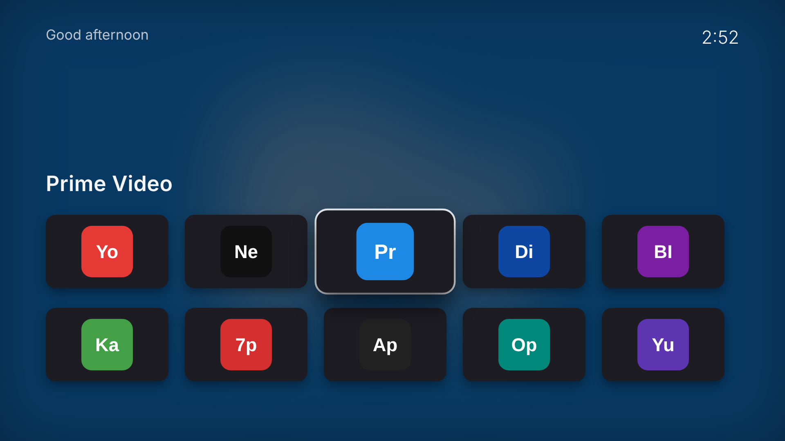

# Clean Home

An ad-free, Apple TV-style launcher for Samsung Tizen TVs. It shows a single grid of the apps you choose, in your order, with each app's own icon from the TV. There are no ads and no recommendation rows. Arrow keys move and OK opens the app.



*The preview uses placeholder icons. On the TV, each tile shows the real app icon.*

**What it can't do:** Samsung doesn't let apps replace the home screen. The house button still opens Samsung's bar, so you open Clean Home from there (pin it as the first tile) or from the computer with `python3 tvctl.py launch CleanHome1.CleanHome`.

To change the apps or their order, edit `FAVOURITES` at the top of `app/main.js` and run `install.sh` again.

## Install (one time)

Everything below is Samsung's official developer tooling. You sign in to your Samsung account yourself; nothing is rooted or flashed.

### 1. Turn on Developer Mode on the TV
1. On the Mac, find its IP address: `ipconfig getifaddr en0`
2. On the remote, open **Apps**, the 4-squares icon on the home bar.
3. On the Apps screen, type **1 2 3 4 5**. The remote's **123** button opens the number pad.
4. Set **Developer mode** to **On**. In **Host PC IP**, enter the Mac's IP, then press **OK**.
5. **Restart the TV:** hold the power button until the Samsung logo appears.

### 2. Install Tizen Studio on the Mac
1. Download **Tizen Studio** (the CLI installer is enough) from https://developer.tizen.org/development/tizen-studio/download and install it to `~/tizen-studio`.
2. Open **Package Manager** (`~/tizen-studio/package-manager/package-manager.app`). Under **Extension SDK**, install **Samsung Certificate Extension** and **TV Extensions**.

### 3. Create the certificate (you sign in to Samsung)
1. Connect to the TV: `~/tizen-studio/tools/sdb connect <TV-IP>`
2. Open **Certificate Manager** (`~/tizen-studio/tools/certificate-manager/`) → **+** → **Samsung** → **TV**.
3. Name the profile **CleanHome**.
4. Create a new author certificate. A browser opens: sign in with your Samsung account.
5. Create the distributor certificate. Keep the connected TV's DUID selected, so the certificate works on your TV.

### 4. Install
```sh
cd samsung-tv/launcher
./install.sh <TV-IP>
```
The script connects to the TV, signs the app, installs it and opens it.

### 5. Pin it first on the home bar
Press the house button, then open **Apps**. Highlight **Clean Home**, press **Down** (or hold **OK**), choose **Move**, and move it to the front.

## Undo
- **Remove the app:** `./install.sh <TV-IP> --remove`, or on the TV go to Apps → Settings → Clean Home → Delete.
- **Developer Mode off:** Apps → **1 2 3 4 5** → Developer mode **Off**, then restart the TV.
